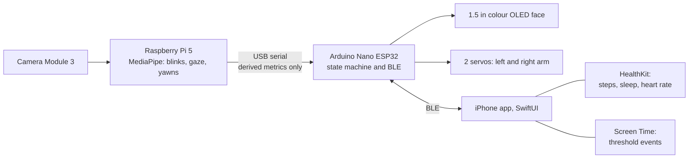

# Study Buddy

**A BMO-inspired desk robot that watches for tiredness and distraction while you study, reacts with a colour OLED face and two waving arms, and syncs with an iPhone app that links to Apple Health and Screen Time.**

Built for the **Edinburgh Award** at the University of Edinburgh School of Informatics Makerspace (October 2026 to summer 2027). "Study Buddy" is a working name.

> **Status:** planning complete, build starting. See the [build log](BUILD_LOG.md).
> **Building this with Claude Code?** Start at [docs/HANDOFF.md](docs/HANDOFF.md).

## Docs

| Doc | What it covers |
|---|---|
| [docs/PLAN.md](docs/PLAN.md) | Architecture, behaviours, mood logic, phases, risks, decisions |
| [docs/PARTS.md](docs/PARTS.md) | Parts list, wiring, power budget, cost |
| [docs/CAD.md](docs/CAD.md) | Fusion 360 plan, dimensions, Ultimaker S3/S5/S7 print settings |
| [docs/PROTOCOL.md](docs/PROTOCOL.md) | Pi to Nano serial protocol and Nano to iPhone BLE protocol |
| [docs/HANDOFF.md](docs/HANDOFF.md) | Build spec and milestone prompts for Claude Code |
| [docs/privacy.md](docs/privacy.md) | What the camera sees and what leaves the robot |

## How it works

1. The **Pi 5** reads the camera, measures blink rate, eye closure, yawns and where you are looking, and sends a small status line to the Nano. No video leaves the Pi.
2. The **Nano ESP32** is the robot's body. It runs the Pomodoro timer, draws the face, moves the arms, and talks Bluetooth LE to the phone. It still works if the Pi is unplugged.
3. The **iPhone app** sets colours, expressions, arm poses and timers, and feeds in Health and Screen Time context so the robot's baseline mood reflects your day.

## Behaviours (v1)

- Pomodoro study and break cycles (default 25/5, adjustable)
- Faces: happy/idle with blinking, focus, break/excited, sad/worried/sleepy
- Tired: sleepy face and a suggestion to take a break
- Distracted: stern face and an arm point to tell you to lock in
- Mood score from sleep, steps, Screen Time thresholds and live fatigue
- App control of face colours, arm angles (0 to 180 degrees) and saved poses
- Per-session focus and tiredness stats in the app

## Hardware at a glance

| Part | Role |
|---|---|
| Raspberry Pi 5 + Camera Module 3 | Vision (MediaPipe), sensor brain |
| Arduino Nano ESP32 | Body controller and BLE to iPhone |
| 1.5 in 128x128 RGB OLED (SSD1351) | Customisable face |
| 2 x MG90S micro servos | Arms, 0 to 180 degrees |
| 3D-printed shell on Ultimaker S3/S5/S7 | Torso and base, teal PLA |

Details and costs in [docs/PARTS.md](docs/PARTS.md).

## Roadmap

- [x] Oct 2026: scope project, price parts, choose Award skills
- [x] Nov 2026: design settled (this plan)
- [ ] Nov 2026: camera and fatigue detection test in real evening light; request the Apple Family Controls entitlement; order parts
- [ ] Dec 2026: Nano bring-up (OLED face, servos), Pi to Nano link, first fit-check print
- [ ] Jan 2027: BLE protocol and SwiftUI app (control, timer, stats)
- [ ] Feb 2027: HealthKit and Screen Time, mood score
- [ ] Mar 2027: final shell print, then **feature freeze**
- [ ] Apr to May 2027: tuning, accuracy write-up, 30-second demo video

**Rules:** the robot must work on its own before app work starts, and no new features after March.

## Out of scope for v1

Ball-joint arms (the shell leaves room for them), contactless face-temperature sensing (a sensor slot is reserved), a battery, laptop activity tracking.

## Tech

Python, MediaPipe, OpenCV, Raspberry Pi OS, Arduino C++ (ESP32 core), Bluetooth LE GATT, Swift/SwiftUI, CoreBluetooth, HealthKit, FamilyControls/DeviceActivity, Fusion 360, Cura.
