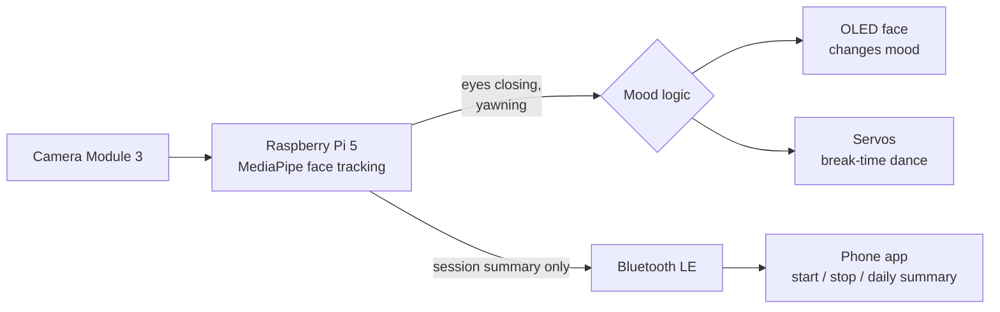
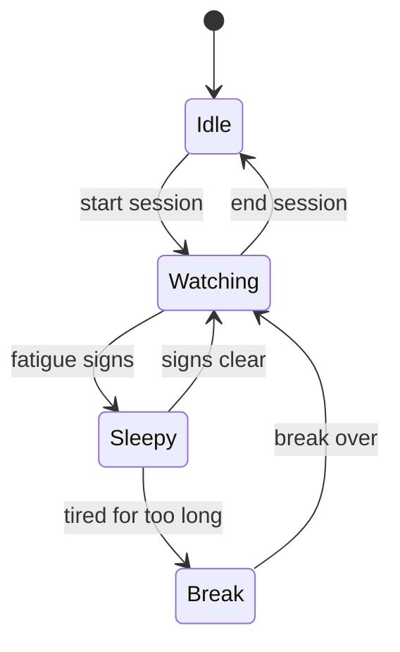

# Study-Break Robot

**A desk robot that notices when you're getting tired while studying and tells you to take a break, like a small pet with a face.**

Built for the **Edinburgh Award** at the University of Edinburgh School of Informatics Makerspace (October 2026 – summer 2027).

> **In progress.** Follow along in the [build log](BUILD_LOG.md).

## How it works

1. You start a study session from the phone app or the button on the robot.
2. The camera watches for signs of tiredness, such as eyes closing for longer and yawning. **All of this happens on the robot itself.**
3. The OLED face changes mood as you get more tired.
4. When it's time for a break, the robot does a short dance.
5. At the end of the day, the app shows how long you studied and how many breaks you took.

## Privacy by design

- Video is processed on the robot and **never stored, recorded or sent anywhere**.
- Only short session summaries (start time, length, number of breaks) go to the phone, over Bluetooth.
- There's no cloud, no account and no internet connection needed.

See [docs/privacy.md](docs/privacy.md).

## Hardware

| Part | What it does |
|---|---|
| Raspberry Pi 5 + Camera Module 3 | Runs face tracking on the robot itself |
| 2.42" OLED display | Animated, Tamagotchi-style face |
| 3 micro servos + PCA9685 driver | The break-time dance |
| 3D-printed body | Vented shell, camera lens cover, servo mounts |
| USB-C wall supply | Runs on its own, no laptop needed |

Estimated cost is about £180 for one unit, or £55–65 if the makerspace lends the Pi, camera and servos. Full list in [docs/hardware.md](docs/hardware.md).

## Robot states

## Roadmap

- [x] Oct 2026: scope project, price parts, choose Award skills
- [ ] Nov 2026: camera test in real evening light; fatigue detection working; accuracy check
- [ ] Dec 2026: OLED face and moods, physical button, idle / watching / break logic
- [ ] Jan–Feb 2027: Bluetooth link and basic app (start, stop, end-of-day screen)
- [ ] Mar 2027: servo dance and first printed body, then **feature freeze**
- [ ] Apr–May 2027: tuning, final body, 30-second demo video

**Rule:** the robot must work on its own before any app work starts, and no new features get added after March.

## Out of scope (on purpose)

Phone screen-time tracking, laptop activity tracking and phone detection. These were left out to keep the project focused and to respect privacy.

## Tech

Python · MediaPipe · OpenCV · Raspberry Pi OS · Bluetooth Low Energy · CAD and 3D printing · Flutter (companion app)
