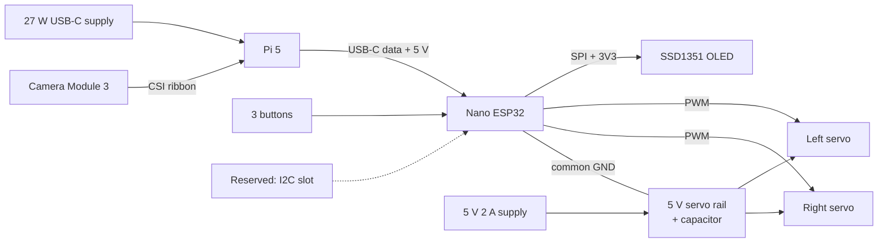

# Parts, wiring and power

Prices are rough UK estimates for planning only. **Check current prices and stock before buying**, and check real part dimensions before finalising the CAD.

## Parts list

| # | Part | Qty | Notes | Approx. cost |
|---|---|---|---|---|
| 1 | Raspberry Pi 5 (4 GB is enough) | 1 | Vision. Makerspace loan if possible | 55 to 60 |
| 2 | Raspberry Pi Active Cooler | 1 | Pi 5 throttles without cooling in an enclosure | 5 |
| 3 | Camera Module 3 (standard, not wide) | 1 | About 75 degree view suits a desk at 50 to 70 cm. Needs the 22-pin to 15-pin Pi 5 camera cable (check if included) | 25 to 30 |
| 4 | Pi 5 camera cable, about 200 mm | 1 | Long enough to reach from the base to the torso | 3 |
| 5 | Official Pi 5 27 W USB-C power supply | 1 | | 12 |
| 6 | microSD card, 32 GB, A2 | 1 | Raspberry Pi OS Bookworm 64-bit | 7 |
| 7 | Arduino Nano ESP32 (with headers) | 1 | Body controller and BLE | 20 |
| 8 | 1.5 in 128x128 RGB OLED, SSD1351, SPI | 1 | Active area about 27 mm square. Buy a module with 3.3 V logic or a level shifter | 15 to 25 |
| 9 | MG90S micro servo (metal gear) | 2 | Arms. Comes with horns and screws | 6 |
| 10 | 5 V 2 A DC supply with barrel jack, plus panel DC jack or screw terminal | 1 | Servo power, separate from the Pi | 8 |
| 11 | Electrolytic capacitor 470 to 1000 uF, 10 V or higher | 2 | Across the servo supply | 1 |
| 12 | Tactile push buttons, 6 mm | 3 | Optional. Start/pause, skip, fun | 2 |
| 13 | Breadboard, jumper wires, ribbon, heat shrink | 1 set | For bring-up, then solder or Dupont | 8 |
| 14 | Short USB-C to USB-C data cable | 1 | Pi USB port to Nano. Data-capable, not charge-only | 4 |
| 15 | Perfboard or small proto shield | 1 | Final wiring | 3 |
| 16 | M2, M2.5, M3 screws and brass heat-set inserts | 1 kit | Assembly | 10 |
| 17 | Teal PLA, 1 kg | 1 | Or use makerspace stock | 20 |
| 18 | MLX90614 (optional, later) | 0 | Face warmth experiment. Slot reserved, not bought for v1 | 12 |

**Rough total:** about 190 to 220 if everything is bought, about 70 to 95 if the makerspace lends the Pi, camera, cooler, supply and servos.

## Block wiring

## Pin plan (Nano ESP32)

**Verify every pin against the official Nano ESP32 pinout before wiring.** The Arduino core uses Dx pin names; use those in code, not raw GPIO numbers.

| Function | Pin | Notes |
|---|---|---|
| OLED SCK | D13 | Hardware SPI |
| OLED MOSI (DIN) | D11 | Hardware SPI |
| OLED CS | D10 | |
| OLED DC | D9 | |
| OLED RST | D8 | |
| OLED VCC | 3V3 | |
| OLED GND | GND | |
| Left servo signal | D5 | PWM |
| Right servo signal | D6 | PWM |
| Button 1 (start/pause) | D2 | INPUT_PULLUP, other leg to GND |
| Button 2 (skip) | D3 | INPUT_PULLUP |
| Button 3 (fun) | D4 | INPUT_PULLUP |
| I2C SDA / SCL (reserved) | A4 / A5 | For the future MLX90614 |

## Power rules

1. **Never power the servos from the Nano or the Pi.** MG90S motors can draw several hundred mA each and spike when they start or stall. Use the separate 5 V supply.
2. **Join the grounds** of the servo supply, Nano and OLED. Without a common ground the PWM signal does not work.
3. Put a **470 to 1000 uF capacitor** across the servo 5 V and GND, close to the servos.
4. The Nano is powered from the Pi over the USB-C data cable. That is fine for the Nano and OLED, which together use well under 300 mA.
5. **Detach the servos when idle** in firmware so they do not buzz or heat up.
6. Do not hot-plug the servo supply while the arms are moving.
7. For first power-up, test the servos with the arms disconnected, sweeping slowly, and stop if anything stalls.

## Camera note

The Pi 5 uses a smaller CSI connector than older Pis. Camera Module 3 usually ships with the older 15-pin cable, so a 22-pin to 15-pin cable is needed. Check this before ordering so a build day is not lost waiting for a cable.

## Reserved for later

| Item | What the design reserves |
|---|---|
| Face warmth sensor (MLX90614) | A 10 mm plug-hole next to the camera, and an I2C header on the perfboard |
| Ball-joint arms | A shoulder mount that can be swapped for a different bracket |
| Speaker | Nothing for v1 |
| Battery | Nothing for v1 |
