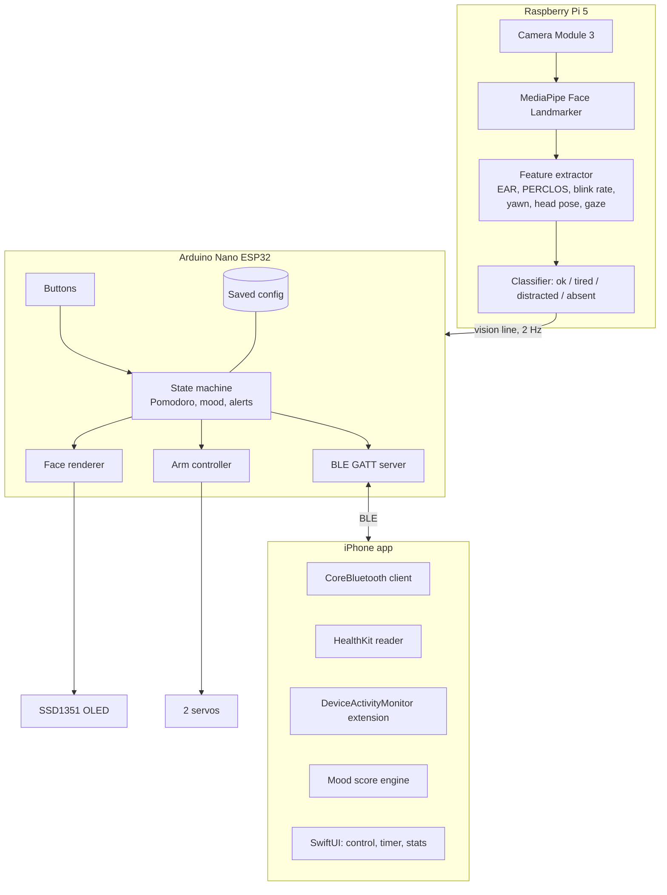

# Plan

## Decisions locked in

| Topic | Decision |
|---|---|
| Vision | Raspberry Pi 5 + Camera Module 3, MediaPipe Face Landmarker, all on the robot |
| Body controller | Arduino Nano ESP32 (ESP32-S3, BLE 5, 3.3 V logic) |
| Link Pi to Nano | USB-C cable, serial (appears as `/dev/ttyACM0` on the Pi) |
| Display | 1.5 in 128x128 RGB OLED (SSD1351), SPI, face drawn from primitives so colours are parameters |
| Arms | 2 micro servos (MG90S), 0 to 180 degrees; ball joints later |
| Phone | iPhone, native SwiftUI, BLE via CoreBluetooth |
| Phone data | HealthKit (steps, sleep, heart rate) and Screen Time (FamilyControls, DeviceActivity) in v1 |
| Power | Wired. Pi on its own 27 W USB-C supply, servos on a separate 5 V supply |
| Buttons | Undecided. Shell has 3 optional button pockets; firmware reserves 3 pins |
| Face warmth | Skipped in v1. An I2C slot and a sensor window are reserved |
| Printer | Ultimaker S3/S5/S7, designed to the S3 build volume to be safe |
| CAD | Fusion 360 |
| Apple account | Paid developer account available |

## Architecture



**Why this split:** the Pi does the heavy vision work properly, and the Nano does real-time display, servo and BLE work. The Nano owns the timer and state so the robot keeps working if the phone or the Pi is missing.

## Behaviours

### Expressions

| Name | When | Face | Arms |
|---|---|---|---|
| `happy` | idle, good mood | smile, random blinks | resting, small wiggle now and then |
| `focus` | study phase | calm narrowed eyes, slow progress arc | resting |
| `excited` | break starts | big smile, bouncing eyes | wave |
| `sleepy` | tired detected, or mood < 40 | half-closed eyes, drooping mouth | slow low wave |
| `worried` | screen time threshold hit | eyebrows up, small frown | arms slightly raised |
| `lockin` | distracted during study | stern flat eyes | one arm points up |

Each face is a function of a colour palette (face fill, eyes, mouth, background, accent), so the app can recolour everything.

### Pomodoro

Study 25 min, break 5 min, long break 15 min after 4 rounds. All adjustable from the app. The Nano runs the timer. Start, pause and skip come from the app or the optional buttons.

### Tiredness and distraction (Pi)

Computed on the Pi from MediaPipe landmarks:

| Signal | Method | Starting threshold (tune per user) |
|---|---|---|
| Blink | Eye aspect ratio (EAR) below threshold for 2 or more frames | EAR < 0.20 |
| Blink rate | Blinks per minute over a 60 s window | Low (< 8) while reading is normal; very high (> 25) can indicate fatigue |
| Eye closure | PERCLOS: fraction of time eyes are mostly closed over 60 s | > 0.15 |
| Long closure | Eyes closed for longer than 0.5 s (microsleep) | any |
| Yawn | Mouth aspect ratio above threshold for about 1.5 s | MAR > 0.6 |
| Distraction | Head yaw/pitch or gaze off the screen for N seconds | > 25 degrees for 8 s |
| Absent | No face for 5 s | informational |

These are research-informed starting points, not medical measures. A 2-minute calibration at session start records your personal baseline EAR and neutral head pose. Looking down at notes will cause false positives, so the app has a **notes mode** and a sensitivity slider. Accuracy, including failures with glasses and low light, gets reported honestly in the write-up.

### Mood score (iPhone)

A 0 to 100 baseline mood the app sends to the robot a few times a day and when inputs change:

```
mood = 100 * (0.30*sleep + 0.20*steps + 0.20*screen + 0.30*session)
sleep   = clamp(hours_slept_last_night / 8, 0, 1)
steps   = clamp(steps_today / step_goal, 0, 1)
screen  = 1 - (highest_screen_time_threshold_tier_hit / max_tier)
session = 1 - live_fatigue_score   (from the Pi, 0 when no session)
```

The weights are starting guesses and are tunable in app settings. Mapping: 70 or above `happy`, 40 to 69 neutral/idle, below 40 `sleepy` or `worried`. During a study phase, `focus` overrides the baseline unless a tired or distracted alert fires.

## iPhone app

| Area | Notes |
|---|---|
| Bluetooth | CoreBluetooth central, auto-reconnect, `bluetooth-central` background mode for updates while the app is backgrounded |
| Control | Colour pickers (face, eyes, mouth, background), expression buttons, arm sliders, saved poses (wave, cheer, shrug, point) |
| Timer | Start, pause, skip, durations, long-break cadence |
| Stats | Per-session tiredness and focus graph from BLE stats notifications, stored locally with SwiftData |
| Health | HealthKit read access for steps, sleep analysis, heart rate. Background delivery for steps and sleep |
| Screen Time | See the caveat below |
| Settings | Thresholds, notes mode, camera on/off, mood weights |

### Screen Time caveat (important)

Apple does not let an app read raw Screen Time totals. The supported route:

1. Request Family Controls authorisation with `.individual` (iOS 16+), and let the user pick apps or categories with `FamilyActivityPicker`.
2. A **DeviceActivityMonitor extension** gets callbacks when usage crosses thresholds you define (for example 30, 60, 120 minutes in a day). The extension can run code at those moments.
3. A **DeviceActivityReport extension** can render usage charts inside your app, but the numbers stay inside the extension's sandbox.
4. The monitor extension writes "threshold tier N reached" to an App Group, the main app reads it, and sends it to the robot.

So the robot reacts to **threshold tiers**, not exact minutes. That is enough for the mood score and for the worried face. The Family Controls capability works for development with a paid account, but **distribution (TestFlight/App Store) needs Apple to approve the entitlement**, which can take time. Request it early (Nov 2026) and verify the current process in Apple's documentation.

## Phases

| Phase | Goal | Done when |
|---|---|---|
| 0. Vision test (Nov) | Fatigue and distraction detection works in evening light | You can see blink, PERCLOS and attention values update live and they respond to you closing eyes or looking away |
| 1. Body (Dec) | Nano draws all faces and moves arms | All 6 expressions and 5 poses run from a serial console |
| 2. Link (Dec) | Pi talks to Nano | Closing your eyes for 3 s makes the robot go sleepy; looking away for 8 s triggers `lockin` |
| 3. Print (Dec to Jan) | First fit-check print | Electronics sit in the shell, display aligned, arms move without rubbing |
| 4. BLE and app (Jan) | App controls everything over BLE | Colours, poses and timer work from the phone and survive reconnect |
| 5. Health and Screen Time (Feb) | Mood score drives the robot | Steps, sleep and a screen time threshold visibly change the face |
| 6. Freeze (Mar) | Final print, no new features | Robot runs a full 2-hour study session unattended |
| 7. Polish (Apr to May) | Tuning, accuracy report, demo | Honest accuracy numbers and a 30-second video |

## Risks

| Risk | Likelihood | Mitigation |
|---|---|---|
| Screen Time entitlement delayed | Medium | Request in Nov; build the mood engine with a manual "screen tier" slider so nothing blocks |
| Fatigue detection inaccurate (glasses, light, looking down) | High | Calibration, notes mode, sensitivity slider, honest reporting, test early |
| Servo jitter or brown-outs | Medium | Separate servo supply, big capacitor, common ground, detach servos when idle |
| Display looks tiny on a big body | Medium | Two-part body: small torso with the display, separate base for the Pi |
| BLE on iOS drops in background | Medium | Auto-reconnect, state restoration, Nano keeps its own timer |
| Scope creep | High | March feature freeze; the camera warmth sensor and ball joints stay out |

## Open items

- Buttons: yes or no (default: build the pockets, fit the buttons if it goes well)
- Final parts check against real part dimensions (display module, MG90S, Pi cooler)
- Whether the makerspace can lend the Pi, camera and servos
- Name and final colour (working default: BMO-like teal)
